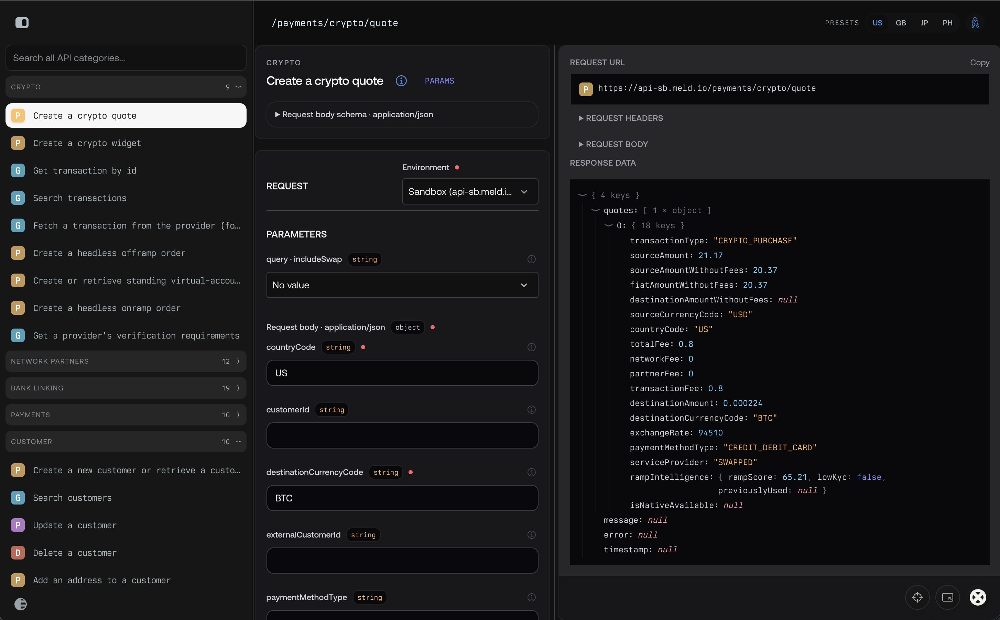

# Meld API Studio

A [Beast](https://www.npmjs.com/package/beast-tsrx) project powered by
[TSRX](https://tsrx.dev/) and [Octane](https://octanejs.dev/).



```bash
bun install
bun run dev
```

For default authentication, copy `.env.example` to `.env` and set
`MELD_API_KEY` to your Meld API key. The server uses this key for dashboard
requests; it is not added to the browser bundle or browser storage. You can
enter an optional per-tab override in the dashboard. `bun run preview` serves
the production build with the same server-side API proxy.

The catalog follows Meld's dated `2026-02-03` OpenAPI reference and groups all 77
operations under Crypto, Network Partners, Bank Linking, Payments, Customer,
Service Providers, Webhooks, and Beta. Service Providers is marked deprecated
and disabled because Meld says that API was removed on July 31, 2026. Requests
use the matching `Meld-Version` header. The theme toggle follows the browser
preference on first load and remembers your choice.

Refresh the generated endpoint catalog from Meld's official OpenAPI specs with:

```bash
bun run sync:meld-api
```

The dashboard composition starts in `src/App.btsx`; endpoint forms and category
navigation live in `src/components/`. `src/lib/meld/catalog.generated.json` is
generated from Meld's OpenAPI specs by `scripts/sync-meld-openapi.ts`.

TanStack Router defines the landing page at `/`, Meld API Studio at `/api`,
account sign-in at `/account/sign-in`, and the gated account dashboard at
`/account` in `src/RouterRoot.btsx`.

The project pins the `octane@0.13.8` toolchain and compatible adapters. Run the
complete local verification before shipping:

```bash
bun run check
```

Use `scope` when setup belongs to an exact child position instead of the whole
component:

```btsx
scope
  setup const label = "Owned by this child";
  p #{label}
```

Octane signals need no build option. Import `octane/signals` in a module to
enable native signal reads there:

```btsx
import { createScope } from "octane/signals"
```

Record application changes in [CHANGELOG.md](CHANGELOG.md).

Node compiler builds require `@tsrx/oxc@0.20.0`. The TSRX type-checking plugin is
pinned to `0.6.3`.

## Selected stack

- Bundler: rsbuild
- UI: base-ui (@octanejs/base-ui)
- Styling: Tailwind CSS v4

```ts
import { Button } from '@octanejs/base-ui/button'
```

## Optional tools

- Beast Devtools: press **Alt+Shift+D** while the dev server runs. Octane profiling is enabled only in development.
- Beast Page Builder: press **⌘B / Ctrl+B** while the dev server runs. Creating routes requires a TanStack router and an app shell with an Outlet; this starter does not create those automatically.
- Beast UI: `bun run beast-ui add button` copies editable components into `src/components/ui`. Tailwind CSS v4 and the `@/*` alias are already configured.
- Beast icons: import `{ Icon }` from `@/lib/icons`. Add SVGs to `src/lib/icons/svg`, then run `bun run icons:build`. Check generated output with `bun run icons:check`.

Setup commands (the builder runs these after installation; run them yourself with `--no-install`):

```sh
bun install
bun run beast-ui init --package-manager bun
bun run beast-ui icons init --framework beast
```
